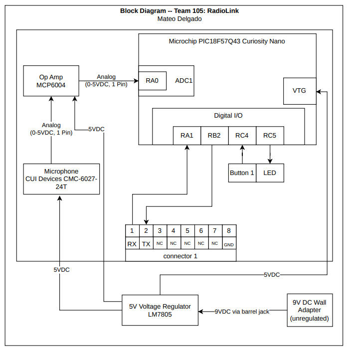

## Overview
Microphone Input Block Diagram - Power starts at a 9 volt DC wall adapter (unregulated), which plugs into the barrel jack and feeds the 5V Voltage Regulator LM7805. The regulator's 5 volt output powers the Curiosity Nano through its VTG pin, along with the microphone and the op amp. The signal starts at a CUI Devices electret microphone. It’s small and cheap, but its output is only millivolts, so it goes into an MCP6004 op amp. I chose that op amp because it’s rail-to-rail, runs from 5 volts, and has four amplifiers in one chip, so I use one and have spares. The amplified signal goes to pin RA0, the ADC on the PIC18F57Q43, which turns sound into numbers. I send those numbers out over UART. I chose UART because it needs only TX, RX and ground, it’s built into the Curiosity Nano, and it connects straight to Sultan’s board through connector 1. I also have a push button on RC4 and a test LED on RC5, which the PIC drives.

