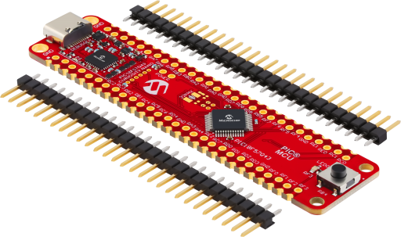
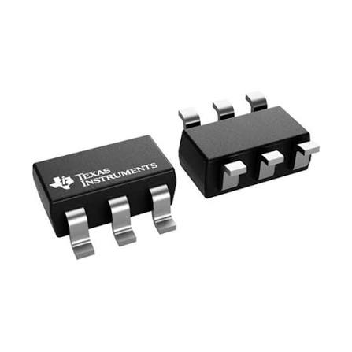
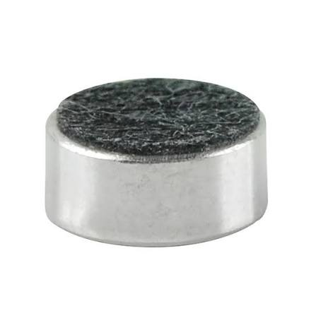
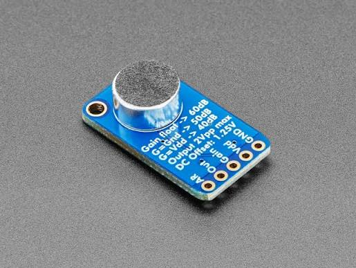
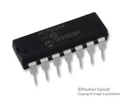
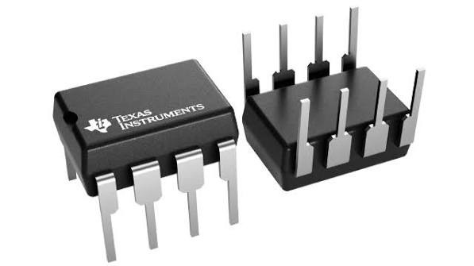

*Table 1: DAC Component Selection

**Digital-to-Analog Converter (DAC) — Individual Subsystem**

| **Solution**                                                                                                                                                                                      | **Pros**                                                                                                                                    | **Cons**                                                                                            |
| ------------------------------------------------------------------------------------------------------------------------------------------------------------------------------------------------- | ------------------------------------------------------------------------------------------------------------------------------------------- | --------------------------------------------------------------------------------------------------- |
|  Option 1.  PIC18F57Q43 Internal 8-bit DAC No additional cost [Link to product](https://www.microchip.com/en-us/product/pic18f57q43)                 | \* No additional cost \* 8-bit output enough for speech \* No SPI Communication required                                              | \* No Dedicated High-Resolution Audio ADC \* Limited Processing Horsepower for DSP \* RAM Constraints for Audio Buffering|
|  \* Option 2.  \* Texas Instruments DAC7512  \* $7/each  \* [Link to product](https://www.ti.com/product/DAC7512) | \* Excellent Audio Fidelity (12-Bit Resolution) \* Rapid Serial Communication (Up to 30 MHz)   \* Glitch-Free Power-On Initialization | * More expensive  \* No Breadboard-Friendly DIP Packages  \* Requires a Completely Custom Software Driver                                                |

**Choice:** Option 2: Texas Instruments DAC7512

**Rationale:** The PIC18F57Q43's internal 8-bit DAC is the best fit for this project. We already own the microcontroller board, so using its built-in peripheral adds no cost and no shipping or lead-time risk. Eight bits is sufficient for speech-quality audio, and the on-chip DAC removes the need for an SPI driver and extra wiring, which keeps both the firmware and the board layout simple. The DAC7512 would offer higher resolution (12-bit) and a buffered output, but that improvement is not needed for voice, and it would add cost, a custom driver, and delivery delays. The main tradeoff is a higher quantization noise floor, which is acceptable for this application.

*Table 2: Microphone Component Selection*

**Microphone — Individual Subsystem**

| **Solution** | **Pros** | **Cons** |
| --- | --- | --- |
|  \* Option 1.  \* CUI Devices CMC-6027-24T Electret Microphone \* Low cost (verify price) \* [Link to product](https://www.cuidevices.com/product/audio/microphones/electret-condenser-microphones/cmc-6027-24t) | \* Low cost \* Small 6 mm through-hole form factor \* Analog output works directly with the PIC's ADC \* Simple to prototype and solder | \* Output signal is very small and needs amplification \* Needs a bias resistor and DC-blocking capacitor \* Analog signal is susceptible to noise |
|  \* Option 2.  \* Adafruit MAX9814 Microphone Amplifier Breakout \* About $8/each (verify price) \* [Link to product](https://www.adafruit.com/product/1713) | \* Built-in amplifier with automatic gain control \* Higher output level, so less external circuitry \* Ready to use on a breadboard | \* More expensive \* Automatic gain control can distort or pump the audio \* Hides the amplifier stage we are supposed to design |

**Choice:** Option 1: CUI Devices CMC-6027-24T Electret Microphone

**Rationale:** The CMC-6027-24T is selected because it is inexpensive, small, and gives a plain analog signal that the PIC18F57Q43's ADC can read once it is amplified. Its output is small, so it pairs with the MCP6004 amplifier stage in the next table, and the extra bias and coupling components are cheap and easy to add. The MAX9814 breakout is more convenient, but it costs more and its built-in gain stage would replace the amplifier circuit that this subsystem is meant to design. The main tradeoff is added circuit complexity and noise sensitivity, which we address with proper decoupling and filtering before the ADC input.

*Table 3: Amplifier Component Selection*

**Operational Amplifier — Individual Subsystem**

| **Solution** | **Pros** | **Cons** |
| --- | --- | --- |
|  \* Option 1.  \* Microchip MCP6004 Quad Op Amp \* Low cost (verify price) \* [Link to product](https://www.microchip.com/en-us/product/mcp6004) | \* Rail-to-rail input and output \* Runs from 1.8 V to 6 V, compatible with the 3.3 V supply \* Low power consumption \* Spare op amps available for filtering | \* Gain-bandwidth of about 1 MHz limits very high gain \* Four amplifiers in one package, so most go unused \* Higher input noise than precision audio op amps |
|  \* Option 2.  \* Texas Instruments LM358 Dual Op Amp \* Low cost (verify price) \* [Link to product](https://www.ti.com/product/LM358) | \* Very common and easy to find \* Through-hole DIP package is breadboard-friendly \* Wide supply range | \* Output cannot swing to the positive rail \* Poor performance at a 3.3 V supply \* Higher power consumption |

**Choice:** Option 1: Microchip MCP6004 Quad Op Amp

**Rationale:** The MCP6004 is selected because it operates from the same 3.3 V supply as the PIC18F57Q43 and has rail-to-rail input and output, so the amplified microphone signal can use the full 0 to 3.3 V range of the ADC. Its low power draw suits a small battery-style design, and the extra amplifiers in the package give us room to add a filter stage if needed. The LM358 is easier to find in a DIP package, but its output cannot reach the supply rails and it does not perform well at 3.3 V. The tradeoff is a modest gain-bandwidth product, which is more than enough for speech frequencies.