*Table 1: DAC Component Selection*

**Digital-to-Analog Converter (DAC) — Individual Subsystem**

| **Solution** | **Pros** | **Cons** |
| --- | --- | --- |
| 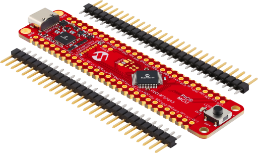 \* Option 1.  \* PIC18F57Q43 Internal 8-bit DAC \* No additional cost \* [Link to product](https://www.microchip.com/en-us/product/pic18f57q43) | \* No additional cost \* 8-bit output enough for speech \* No SPI communication required | \* Only 8-bit resolution \* Limited processing horsepower for DSP \* RAM constraints for audio buffering |
| 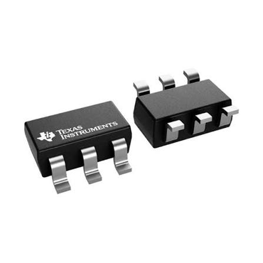 \* Option 2.  \* Texas Instruments DAC7512  \* $7/each  \* [Link to product](https://www.ti.com/product/DAC7512) | \* Excellent audio fidelity (12-bit resolution) \* Rapid serial communication (up to 30 MHz) \* Glitch-free power-on initialization | \* More expensive \* No breadboard-friendly DIP package \* Requires a completely custom software driver |
|  \* Option 3.  \* Microchip MCP4725 12-bit I2C DAC \* Low cost (verify price) \* [Link to product](https://www.microchip.com/en-us/product/mcp4725) | \* 12-bit resolution \* Runs from 2.7 V to 5.5 V, compatible with the 5 V supply \* Simple two-wire I2C interface \* Built-in EEPROM remembers its last output setting | \* Costs more than the internal DAC \* Needs an I2C driver and extra wiring \* I2C speed limits how fast samples can be updated |

**Choice:** Option 1: PIC18F57Q43 Internal 8-bit DAC

**Rationale:** The PIC18F57Q43's internal 8-bit DAC is the best fit for this project. We already own the microcontroller board, so using its built-in peripheral adds no cost and no shipping or lead-time risk. Eight bits is sufficient for speech-quality audio, and the on-chip DAC removes the need for an SPI or I2C driver and extra wiring, which keeps both the firmware and the board layout simple. The DAC7512 and MCP4725 would offer higher resolution (12-bit), but that improvement is not needed for voice, and either one would add cost, a custom driver, and delivery delays. The main tradeoff is a higher quantization noise floor, which is acceptable for this application.

*Table 2: Microphone Component Selection*

**Microphone — Individual Subsystem**

| **Solution** | **Pros** | **Cons** |
| --- | --- | --- |
| 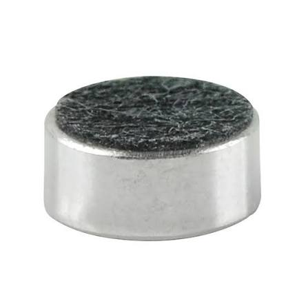 \* Option 1.  \* CUI Devices CMC-6027-24T Electret Microphone \* Low cost (verify price) \* [Link to product](https://www.cuidevices.com/product/audio/microphones/electret-condenser-microphones/cmc-6027-24t) | \* Low cost \* Small 6 mm through-hole form factor \* Analog output works directly with the PIC's ADC \* Simple to prototype and solder \* Can be biased from the 5 V supply | \* Output signal is very small and needs amplification \* Needs a bias resistor and DC-blocking capacitor \* Analog signal is susceptible to noise |
| 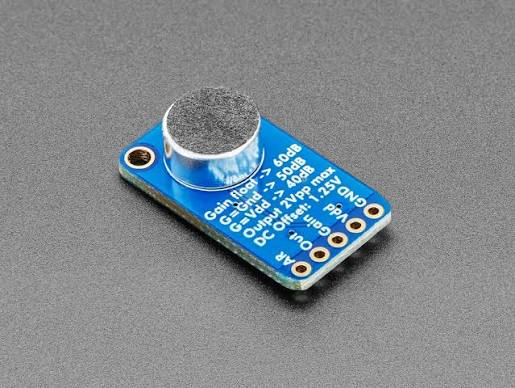 \* Option 2.  \* Adafruit MAX9814 Microphone Amplifier Breakout \* About $8/each (verify price) \* [Link to product](https://www.adafruit.com/product/1713) | \* Built-in amplifier with automatic gain control \* Higher output level, so less external circuitry \* Ready to use on a breadboard | \* More expensive \* Automatic gain control can distort or pump the audio \* Hides the amplifier stage we are supposed to design |
| 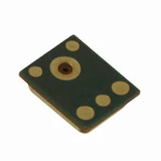 \* Option 3.  \* Knowles SPU0410LR5H-QB Analog MEMS Microphone \* Moderate cost (verify price) \* [Link to product](https://www.digikey.co.uk/en/products/detail/syntiant/SPU0410LR5H-QB/2420983) | \* Very small and consistent from part to part \* Built-in preamplifier, so a larger output signal \* Low noise and flat frequency response | \* Surface-mount only, which does not fit our through-hole PCB \* Supply voltage is limited to about 3.6 V, below our 5 V rail \* More expensive than an electret capsule |

**Choice:** Option 1: CUI Devices CMC-6027-24T Electret Microphone

**Rationale:** The CMC-6027-24T is selected because it is inexpensive, small, and gives a plain analog signal that the PIC18F57Q43's ADC can read once it is amplified. It is a through-hole part, so it fits our PCB, and it can be biased directly from the 5 V rail. Its output is small, so it pairs with the MCP6004 amplifier stage in the next table, and the extra bias and coupling components are cheap and easy to add. The MAX9814 breakout is more convenient, but it costs more and its built-in gain stage would replace the amplifier circuit that this subsystem is meant to design. The MEMS microphone is compact and quiet, but it is surface-mount only and cannot run from our 5 V rail without extra circuitry. The main tradeoff of the electret is added circuit complexity and noise sensitivity, which we address with proper decoupling and filtering before the ADC input.

    
*Table 3: Amplifier Component Selection*

**Operational Amplifier — Individual Subsystem**

| **Solution** | **Pros** | **Cons** |
| --- | --- | --- |
| 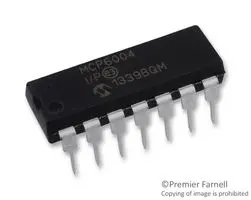 \* Option 1.  \* Microchip MCP6004 Quad Op Amp \* Low cost (verify price) \* [Link to product](https://www.microchip.com/en-us/product/mcp6004) | \* Rail-to-rail input and output \* Runs from 1.8 V to 6 V, compatible with the 5 V supply \* Low power consumption \* Spare op amps available for buffering the half-supply reference | \* Gain-bandwidth of about 1 MHz limits very high gain \* Four amplifiers in one package, so most go unused \* Higher input noise than precision audio op amps |
| 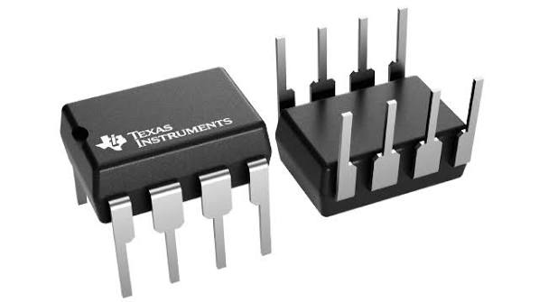 \* Option 2.  \* Texas Instruments LM358 Dual Op Amp \* Low cost (verify price) \* [Link to product](https://www.ti.com/product/LM358) | \* Very common and easy to find \* Through-hole DIP package is breadboard-friendly \* Wide supply range | \* Output cannot swing to the positive rail, wasting part of the ADC range on a 5 V supply \* Not rail-to-rail, so it handles a single-supply audio signal poorly \* Higher power consumption |
| 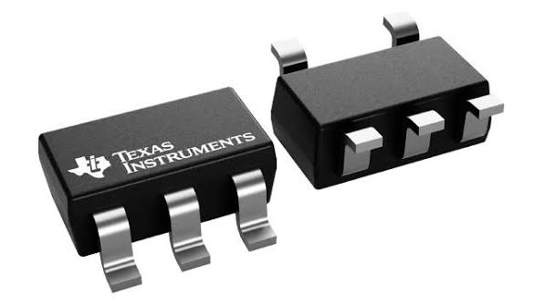 \* Option 3.  \* Texas Instruments TLV9001 Single Op Amp \* Low cost (verify price) \* [Link to product](https://www.ti.com/product/TLV9001) | \* Rail-to-rail input and output \* Runs from 1.8 V to 5.5 V, compatible with the 5 V supply \* Low power consumption | \* Single amplifier, so there are no spares to buffer the half-supply reference \* Only available in surface-mount packages, which does not fit our through-hole PCB \* Gain-bandwidth of about 1 MHz limits very high gain |

**Choice:** Option 1: Microchip MCP6004 Quad Op Amp

**Rationale:** The MCP6004 is selected because it runs from the same 5 V rail as the rest of the subsystem and has rail-to-rail input and output, so the amplified microphone signal can use the full 0 to 5 V range of the ADC around the 2.5 V half-supply reference. Its low power draw suits a small design, and the extra amplifiers in the package are used as buffers on the half-supply reference so they do not pick up noise. The LM358 is easier to find in a DIP package, but its output cannot reach the positive rail. The TLV9001 has similar electrical performance, but it is a single amplifier in a surface-mount package only. The tradeoff is a modest gain-bandwidth product, which is more than enough for speech frequencies.

*Table 4: Voltage Regulator Component Selection*

**Voltage Regulator — Individual Subsystem**

| **Solution** | **Pros** | **Cons** |
| --- | --- | --- |
| 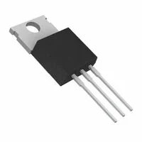 \* Option 1.  \* onsemi MC7805CTG 5 V Linear Regulator (TO-220) \* Low cost (verify price) \* [Link to product](https://www.arrow.com/en/products/mc7805ctg/on-semiconductor) | \* Fixed 5 V output with no adjustment needed \* Accepts a 9 V wall adapter (input up to 35 V) \* Delivers up to 1 A \* Through-hole package fits our PCB \* Built-in thermal overload and current limiting | \* Dropout of about 2 V, so it needs at least 7 V in \* Wastes the voltage difference as heat \* Bulkier than newer low-dropout parts |
| 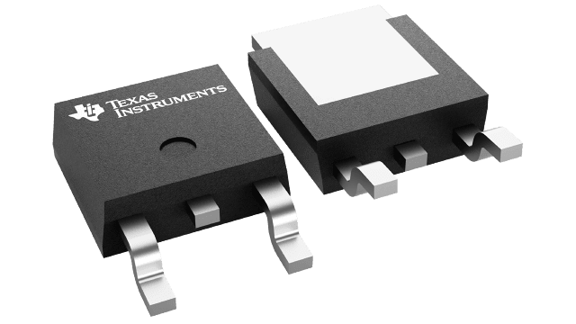 \* Option 2.  \* Texas Instruments TLV761 (5.0 V fixed-output version) \* Low cost (verify price) \* [Link to product](https://www.ti.com/product/TLV761) | \* Input voltage up to 18 V, so a 9 V adapter works \* Delivers up to 1 A \* Low dropout, about 0.9 V typical at 1 A \* Low quiescent current, about 60 µA \* ±1% output accuracy \* Stable with a 1 µF ceramic output capacitor | \* Surface-mount only (SOT-223 or TO-252), which does not fit our through-hole PCB \* The 5.0 V version must be ordered specifically \* Harder to hand-solder than a TO-220 |
| 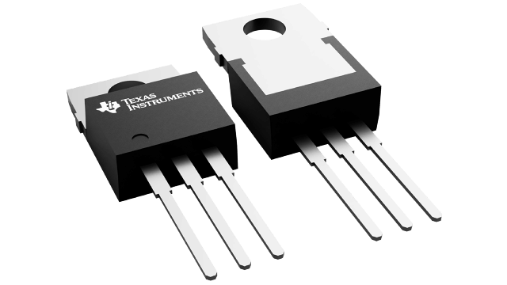 \* Option 3.  \* LM2940-5.0 Low-Dropout 5 V Regulator \* Moderate cost (verify price) \* [Link to product](https://www.ti.com/product/LM2940-N) | \* Very low dropout, about 0.5 V \* Delivers up to about 1 A \* Wide input voltage range | \* More expensive \* Requires an output capacitor of at least 22 µF with controlled ESR \* More demanding to lay out |

**Choice:** Option 1: onsemi MC7805CTG 5 V Linear Regulator

**Rationale:** The MC7805CTG is selected because the whole subsystem runs from a single 5 V rail, and the unregulated 9 V DC wall adapter plugs into a barrel jack and gives it plenty of headroom above the regulator's 2 V dropout. It is a through-hole TO-220 part, so it matches our PCB, and it needs only a small input and output capacitor. The subsystem draws well under 100 mA, so the heat wasted dropping 9 V to 5 V is small and no heat sink is needed. The TLV761 and LM2940 have lower dropout and better efficiency, but we do not need that with a 9 V source, and the TLV761 is surface-mount only, which does not fit our through-hole PCB. The tradeoff of the MC7805CTG is the wasted power as heat, which is acceptable at this current.