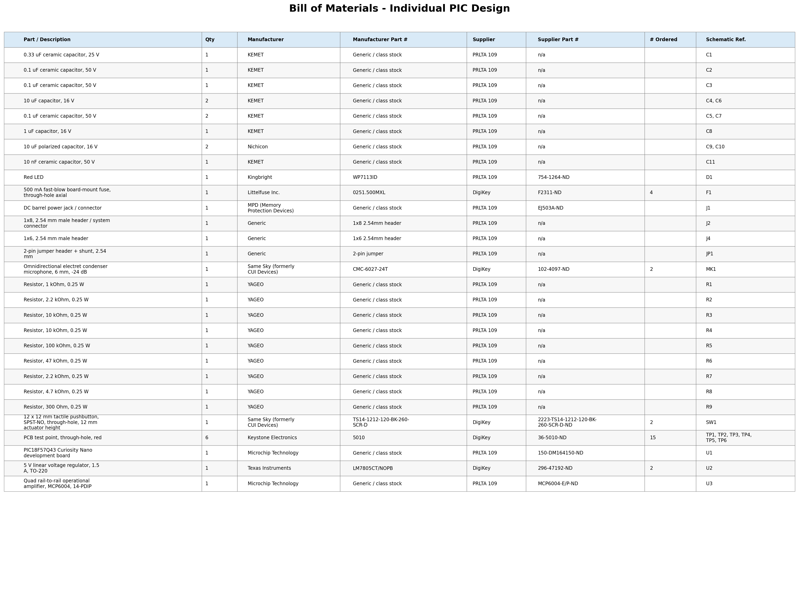

## Overview

The Bill of Materials below lists the components required for my subsystem. Components include parts required for prototyping, PCB assembly, and additional components in case of damage or failure. Parts available in Peralta 109 are listed at no additional cost, while components that need to be purchased include their corresponding supplier information.

## Bill of Materials

*Table 1: Bill of Materials for my subsystem.*

| **Part Name/Description** | **Qty** | **Unit Cost** | **Total Cost** | **Manufacturer** | **Manufacturer #** | **Vendor Link** | **Datasheet Link** | **Schematic Reference Designators** |
|:---|:---:|:---:|:---:|:---|:---|:---|:---|:---|
| 0.33 uF ceramic capacitor, 25 V | 1 | $0.00 | $0.00 | KEMET | Generic / class stock | PRLTA 109 | n/a | C1 |
| 0.1 uF ceramic capacitor, 50 V | 1 | $0.00 | $0.00 | KEMET | Generic / class stock | PRLTA 109 | n/a | C2 |
| 0.1 uF ceramic capacitor, 50 V | 1 | $0.00 | $0.00 | KEMET | Generic / class stock | PRLTA 109 | n/a | C3 |
| 10 uF capacitor, 16 V | 2 | $0.00 | $0.00 | KEMET | Generic / class stock | PRLTA 109 | n/a | C4, C6 |
| 0.1 uF ceramic capacitor, 50 V | 2 | $0.00 | $0.00 | KEMET | Generic / class stock | PRLTA 109 | n/a | C5, C7 |
| 1 uF capacitor, 16 V | 1 | $0.00 | $0.00 | KEMET | Generic / class stock | PRLTA 109 | n/a | C8 |
| 10 uF polarized capacitor, 16 V | 2 | $0.00 | $0.00 | Nichicon | Generic / class stock | PRLTA 109 | n/a | C9, C10 |
| 10 nF ceramic capacitor, 50 V | 1 | $0.00 | $0.00 | KEMET | Generic / class stock | PRLTA 109 | n/a | C11 |
| Red LED | 1 | $0.00 | $0.00 | Kingbright | WP7113ID | PRLTA 109 | n/a | D1 |
| 500 mA fast-blow board-mount fuse, through-hole axial | 1 | $1.37 | $1.37 | Littelfuse Inc. | 0251.500MXL | [DigiKey](https://www.digikey.com/en/products/detail/littelfuse-inc/0251-500MXL/700707) | [Datasheet](https://www.littelfuse.com/media?resourcetype=datasheets&itemid=5d54f72b-0d9f-49f8-8d17-fc51e2bfb5ad&filename=littelfuse-fuse-251-253-datasheet) | F1 |
| DC barrel power jack / connector | 1 | $0.00 | $0.00 | MPD (Memory Protection Devices) | Generic / class stock | PRLTA 109 | n/a | J1 |
| 1x8, 2.54 mm male header / system connector | 1 | $0.00 | $0.00 | Generic | 1x8 2.54mm header | PRLTA 109 | n/a | J2 |
| 1x6, 2.54 mm male header | 1 | $0.00 | $0.00 | Generic | 1x6 2.54mm header | PRLTA 109 | n/a | J4 |
| 2-pin jumper header + shunt, 2.54 mm | 1 | $0.00 | $0.00 | Generic | 2-pin jumper | PRLTA 109 | n/a | JP1 |
| Omnidirectional electret condenser microphone, 6 mm, -24 dB | 1 | $3.08 | $3.08 | Same Sky (formerly CUI Devices) | CMC-6027-24T | [DigiKey](https://www.digikey.com/en/products/detail/same-sky-formerly-cui-devices/CMC-6027-24T/6561035) | n/a | MK1 |
| Resistor, 1 kOhm, 0.25 W | 1 | $0.00 | $0.00 | YAGEO | Generic / class stock | PRLTA 109 | n/a | R1 |
| Resistor, 2.2 kOhm, 0.25 W | 1 | $0.00 | $0.00 | YAGEO | Generic / class stock | PRLTA 109 | n/a | R2 |
| Resistor, 10 kOhm, 0.25 W | 1 | $0.00 | $0.00 | YAGEO | Generic / class stock | PRLTA 109 | n/a | R3 |
| Resistor, 10 kOhm, 0.25 W | 1 | $0.00 | $0.00 | YAGEO | Generic / class stock | PRLTA 109 | n/a | R4 |
| Resistor, 100 kOhm, 0.25 W | 1 | $0.00 | $0.00 | YAGEO | Generic / class stock | PRLTA 109 | n/a | R5 |
| Resistor, 47 kOhm, 0.25 W | 1 | $0.00 | $0.00 | YAGEO | Generic / class stock | PRLTA 109 | n/a | R6 |
| Resistor, 2.2 kOhm, 0.25 W | 1 | $0.00 | $0.00 | YAGEO | Generic / class stock | PRLTA 109 | n/a | R7 |
| Resistor, 4.7 kOhm, 0.25 W | 1 | $0.00 | $0.00 | YAGEO | Generic / class stock | PRLTA 109 | n/a | R8 |
| Resistor, 300 Ohm, 0.25 W | 1 | $0.00 | $0.00 | YAGEO | Generic / class stock | PRLTA 109 | n/a | R9 |
| 12 x 12 mm tactile pushbutton, SPST-NO, through-hole, 12 mm actuator height | 1 | $0.30 | $0.30 | Same Sky (formerly CUI Devices) | TS14-1212-120-BK-260-SCR-D | [DigiKey](https://www.digikey.com/en/products/detail/same-sky-formerly-cui-devices/TS14-1212-120-BK-260-SCR-D/16562671) | n/a | SW1 |
| PCB test point, through-hole, red | 6 | $0.30 | $1.80 | Keystone Electronics | 5010 | [DigiKey](https://www.digikey.com/en/products/detail/keystone-electronics/5010/255332) | n/a | TP1, TP2, TP3, TP4, TP5, TP6 |
| PIC18F57Q43 Curiosity Nano development board | 1 | $0.00 | $0.00 | Microchip Technology | Generic / class stock | PRLTA 109 | [Datasheet / Product Page](https://www.microchip.com/en-us/development-tool/dm164150) | U1 |
| 5 V linear voltage regulator, 1.5 A, TO-220 | 1 | $1.86 | $1.86 | Texas Instruments | LM7805CT/NOPB | [DigiKey](https://www.digikey.com/en/products/detail/texas-instruments/LM7805CT-NOPB/3901929) | n/a | U2 |
| Quad rail-to-rail operational amplifier, MCP6004, 14-PDIP | 1 | $0.00 | $0.00 | Microchip Technology | Generic / class stock | PRLTA 109 | [Datasheet](http://ww1.microchip.com/downloads/en/DeviceDoc/21733j.pdf) | U3 |

## Bill of Materials (as Image)
{style width: "2000"}
**Figure 2:** Bill of Materials as a screenshot.

As you can see, the text can be difficult to read without opening the image.
