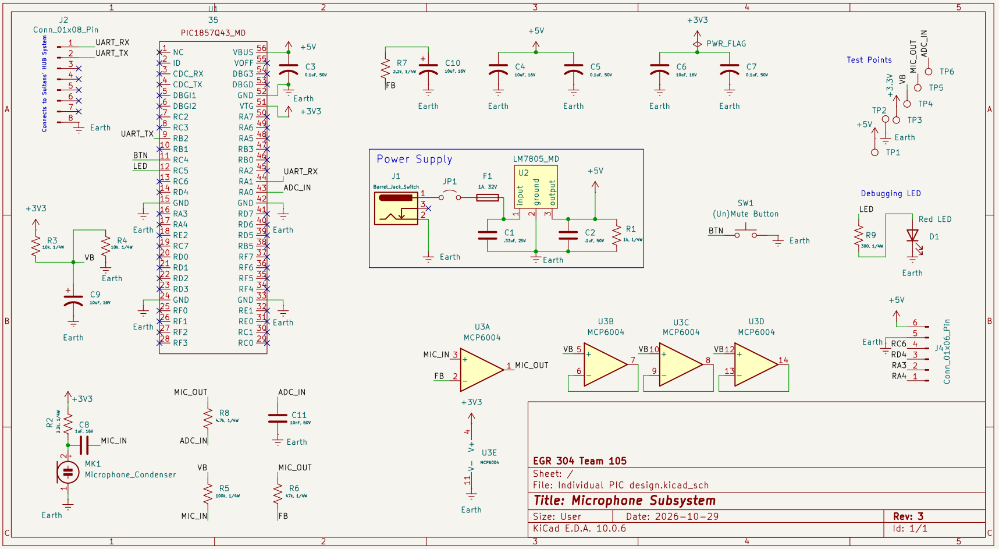

## Overview

Starting with power: a 9 volt barrel jack feeds an LM7805 regulator through a 1 amp fuse and a jumper (JP1) that lets me disconnect power. Capacitors on the regulator's input and output give a clean 5 volts. That feeds the Nano's VBUS pin. The Nano makes its own 3.3 volts, and I take that from the VTG pin to power the mic and op amp, so the signal can never go higher than the PIC's ADC can handle.

For the mic, a 2.2k resistor from 3.3 volts biases it. A 1 microfarad capacitor blocks DC and passes only the sound. Because I only have a single supply, I build a half-supply reference of about 1.65 volts, called VB, with two 10k resistors and a 10 microfarad capacitor. A 100k resistor ties the op amp input to VB.

The op amp is a non-inverting amplifier. A 47k feedback resistor and a 2.2k resistor in series with a 10 microfarad capacitor to ground give about 22 times gain on audio. DC passes at a gain of one, so the 1.65 volt center stays put. I wired the three unused amplifiers as buffers on VB, so they don't pick up noise.

The output goes through a 4.7k resistor and a 10 nanofarad capacitor. That's a low-pass filter at about 3.4 kilohertz, which protects RA0 and reduces aliasing at an 8 kilohertz sample rate.

The 8-pin header (J2) connects to Sultan's system: RX on pin 1 (RA1), TX on pin 2 (RB2), and ground on pin 8, matching our block diagram. Pins 3 through 7 are not connected. A second header (J4) breaks out spare GPIO (RC6, RD4, RA3, RA4) with 5 volts and ground. The (un)mute button on RC4 pulls the pin to ground, and the debugging LED on RC5 has a 300 ohm resistor. I added test points for 5 volts, 3.3 volts, ground, VB, MIC_OUT and ADC_IN, put no-connect flags on every unused pin, and ran KiCad's electrical rules check to catch mistakes.

{style width:"350" height:"300;"}

## Resouces

The schematic as a PDF download is available [*here*](schematicrev3.pdf) and the Zip folder of the project [*here*](IndividualSubSystem.zip).