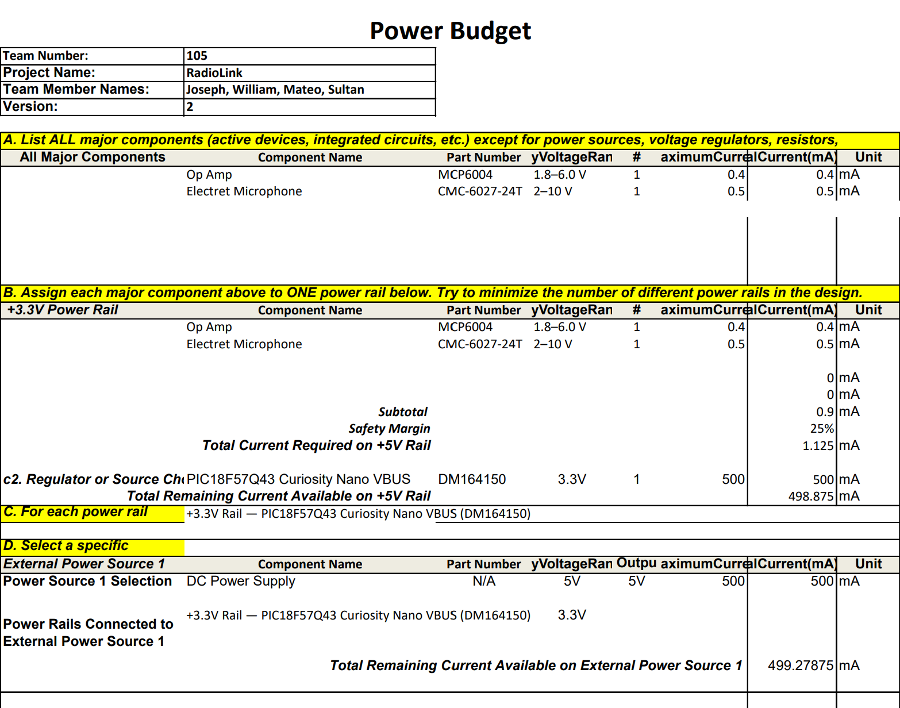

## Overview
A power budget was created to determine the current requirements of the microphone subsystem and verify that the selected power supply can safely support the complete circuit. The board uses a single 3.3 V power rail supplied by an external DC power supply, which provides the voltage directly to the circuit. Current requirements were estimated for the MCP6004 operational amplifier and the CMC-6027-24T electret microphone. The DAC is the PIC18F57Q43’s internal 8-bit DAC, so it is part of the microcontroller and does not add a separate load.

The estimated maximum current consumption of these components is approximately 0.9 mA. A 25% safety margin was added to account for variations in component current consumption and operating conditions, resulting in a design requirement of approximately 1.13 mA on the 3.3 V rail. This value was then compared with the 500 mA rating of the external power supply to verify that sufficient current capacity is available.

{style width:"350" height:"300;"}

## Conclusions
The completed power budget indicates that the microphone subsystem can operate from a single 3.3 V power rail supplied by an external DC power supply. After applying the 25% safety margin, the calculated maximum current requirement is approximately 1.13 mA. The power supply is rated for up to 500 mA, leaving approximately 498.9 mA of current capacity beyond the calculated design requirement.

Because the subsystem draws only a small fraction of the available current, no additional voltage regulator is required. The CMC-6027-24T electret microphone represents the largest portion of the estimated current consumption, followed by the MCP6004 operational amplifier. The power budget demonstrates that the selected supply provides adequate current capacity, although the actual current consumption should be measured during subsystem verification to confirm the design estimates.
## Resouces

The power budget as a PDF download is available [*here*](powerrevised.pdf), and a Microsoft Excel Sheet [*here*](PowerBudgetMateoDelgado-Individual2.xlsx).