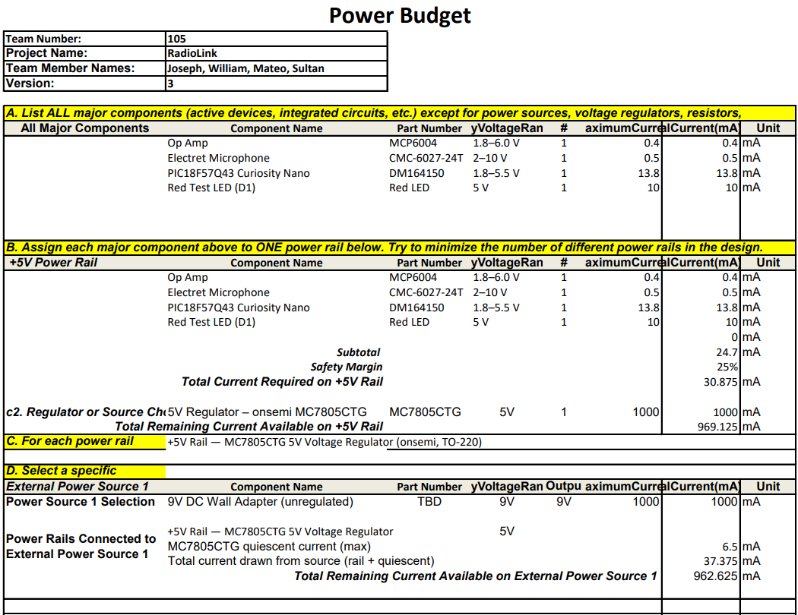

## Overview
A power budget was created to determine the current requirements of the microphone subsystem and verify that the selected power source can safely support the complete circuit. The board uses a single 5 V power rail. A 9 V DC wall adapter feeds an onsemi MC7805CTG linear regulator, which produces the 5 V rail and powers the Curiosity Nano through its VTG pin. Current requirements were estimated for the MCP6004 operational amplifier, the CMC-6027-24T electret microphone, the PIC18F57Q43 Curiosity Nano, and the red test LED. The DAC is the PIC18F57Q43’s internal 8-bit DAC, so it is part of the microcontroller and does not add a separate load.

The estimated maximum current consumption of these components is approximately 24.7 mA. A 25% safety margin was added to account for variations in component current consumption and operating conditions, resulting in a design requirement of approximately 30.9 mA on the 5 V rail. This value was compared with the 1000 mA rating of the MC7805CTG, and then the regulator’s input current (rail current plus its quiescent current) was compared with the rating of the 9 V wall adapter to verify that sufficient current capacity is available.

{style width:"350" height:"300;"}

## Conclusions
The completed power budget indicates that the microphone subsystem can operate from a single 5 V rail. After applying the 25% safety margin, the calculated maximum current requirement is approximately 30.9 mA. The MC7805CTG is rated for 1000 mA, leaving approximately 969 mA of capacity on the rail. The regulator draws about 37.4 mA from the 9 V wall adapter, which leaves more than 960 mA of capacity on the external source.

The PIC18F57Q43 Curiosity Nano and the red test LED represent the largest portions of the estimated current consumption, while the MCP6004 and the microphone draw very little. The 1 kΩ output load resistor and the half-supply voltage divider draw about 5 mA together, which is covered by the safety margin. The power budget demonstrates that the selected regulator and wall adapter provide adequate current capacity, although the actual current consumption should be measured during subsystem verification to confirm the design estimates.
## Resouces

The power budget as a PDF download is available [*here*](powerrev3.pdf), and a Microsoft Excel Sheet [*here*](Power_Budget_Mateo_Delgado_-_Individual.xlsx).