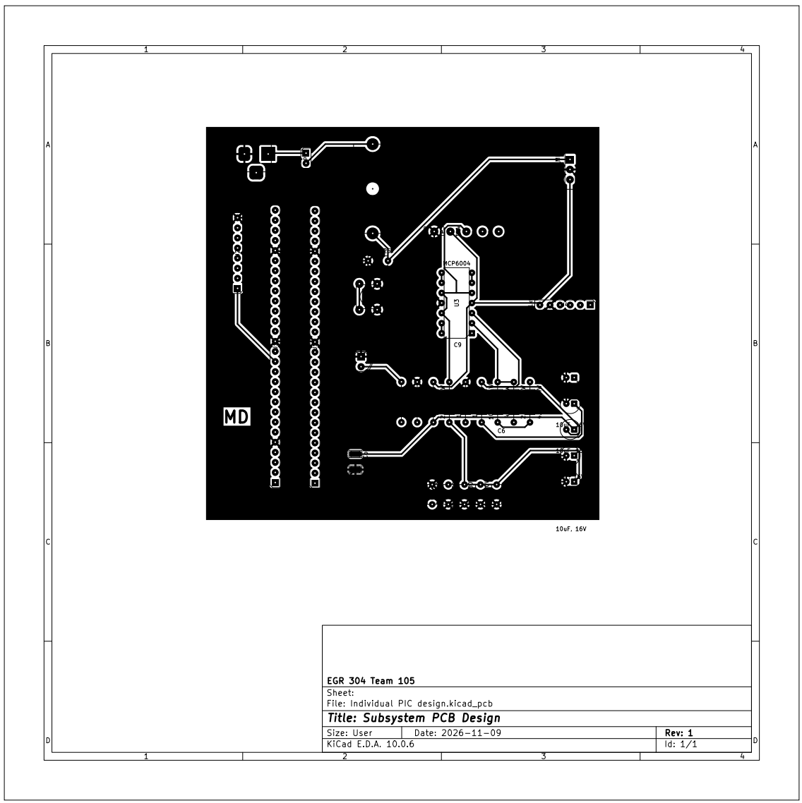
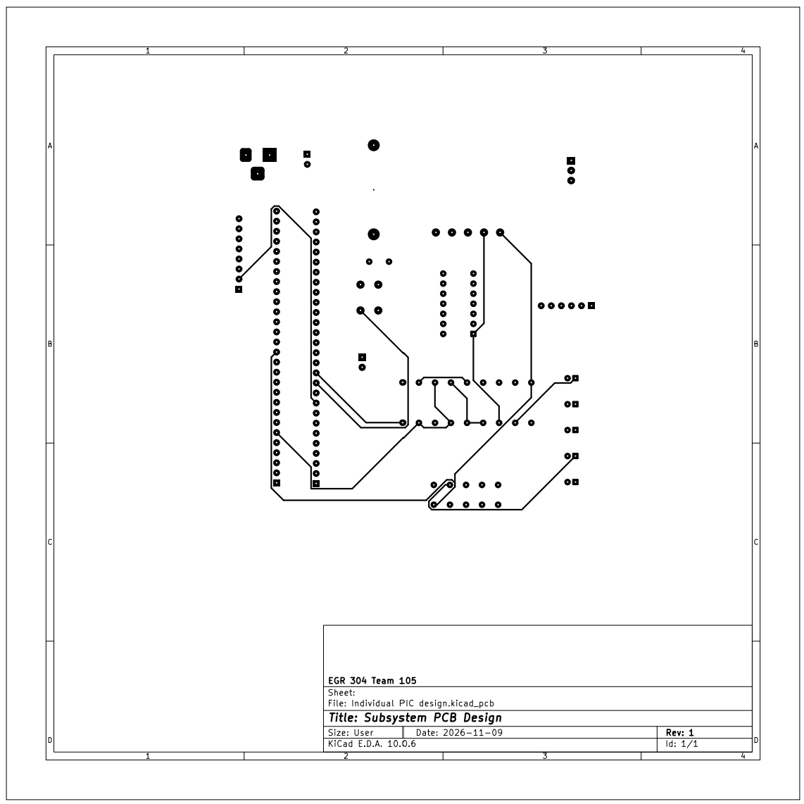
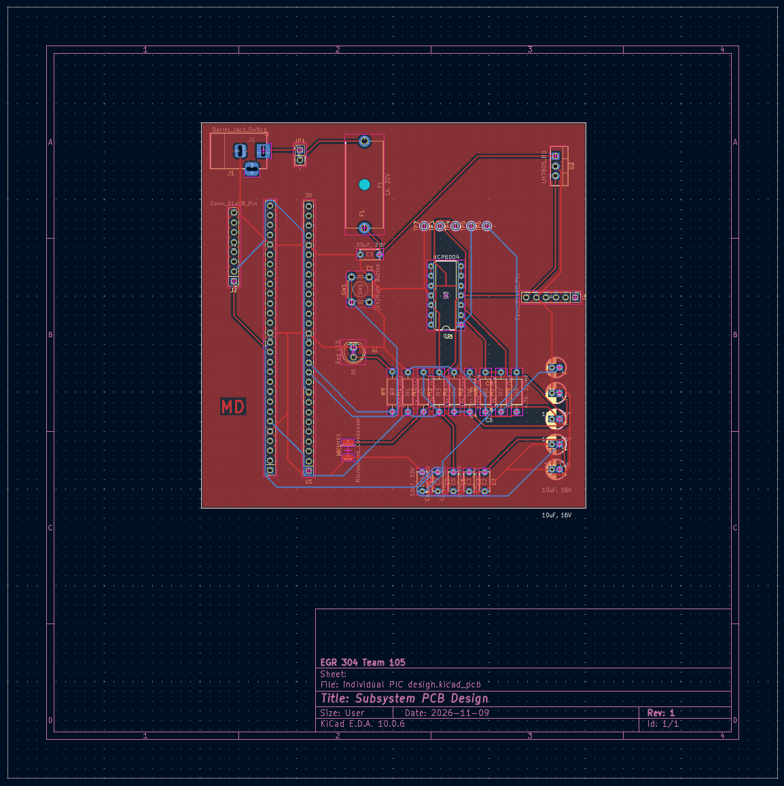

## Overview

The physical layout translates the verified schematic onto a dual-layer printed circuit board meticulously optimized for signal integrity, noise isolation, and manufacturing requirements. The entire design is constrained to a compact physical footprint under 100mm x 100mm, routed precisely on the Edge.Cuts layer.

### Design Rules and Routing Strategy
To meet the stringent Peralta PCB mill specifications, trace widths and spacing rules were strictly applied across the entire layout:
* **Signal Traces:** Configured with a standard trace width of 0.4mm and a clearance rule of 0.254mm to eliminate the risk of mill-bridge shorts.
* **Power Distribution:** High-current traces (>500mA) along the primary 5V supply rail are routed at an expanded width of 0.8mm to 1.0mm to handle current demands safely and reduce trace impedance.
* **Ground Planes:** Solid copper ground zones are poured across both the top (`F.Cu`) and bottom (`B.Cu`) layers, tied directly to the Earth/GND net. These continuous planes provide an excellent low-impedance return path for the high-frequency digital lines of the PIC microcontroller, suppressing switching transients and shielding the fragile analog audio signals.

### Component Placement and Signal Integrity
Components are arranged logically to separate noisy digital switching circuits from high-gain analog audio elements:
* **Analog Section:** The electret microphone biasing network, the half-supply voltage reference ($V_B$), and the non-inverting op-amp circuitry are grouped closely together to keep high-impedance traces as short as possible, preventing noise pickup.
* **Digital Section:** The PIC18F57Q43 Curiosity Nano module sits centralized to streamline routing to the off-board system headers. Unused op-amp pins are cleanly tied to buffers to prevent floating oscillations.
* **Manufacturing Details:** To meet submission criteria, custom footprint pad mappings were fully matched with their schematic pin configurations. Large, bold initials (**MD**) are permanently etched directly into the copper on the top layer (`F.Cu`) for unmistakable board identification. Test points are left fully accessible to facilitate rapid probing of the 5V, GND, VB, MIC_OUT, and ADC_IN nodes.

**PCB Layout Top and Bottom**

{style="width: 350px; height: 300px;"}
{style="width: 350px; height: 300px;"}
{style="width: 350px; height: 300px;"}
## Resources

The manufacturing files and layout plots are available for download below:
* *fcu and bcu PDFs:* [*F.cu*](pcbfcu2.pdf) [*B.cu*](pcbbcu1.pdf)
* *Gerbers and the drill* [*here*](GERBERS.zip)

